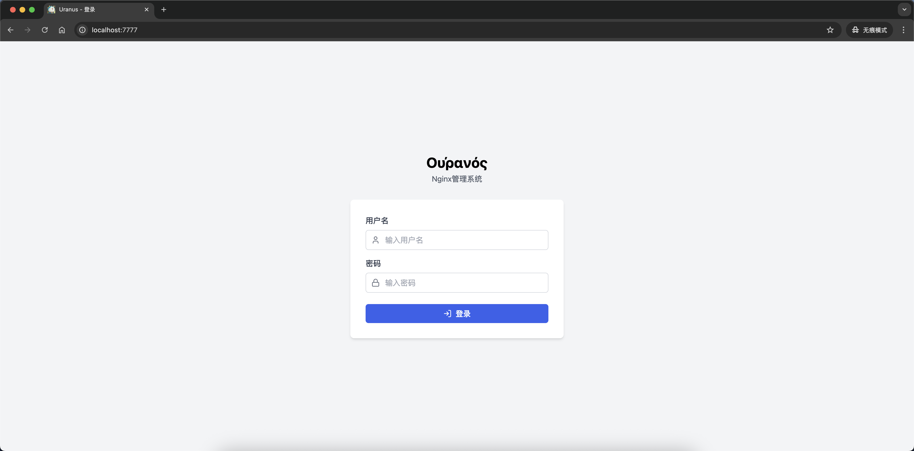
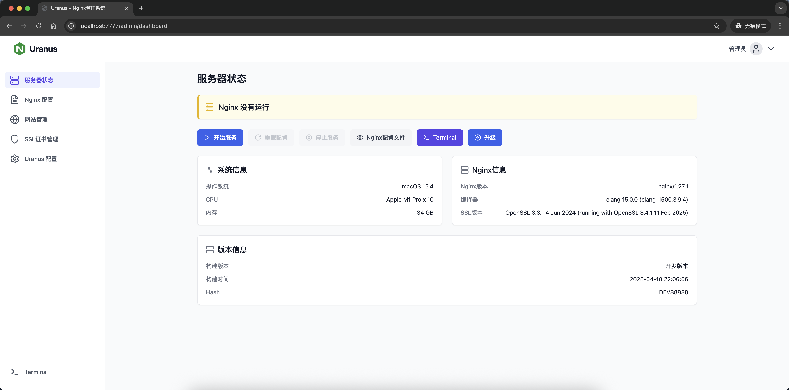
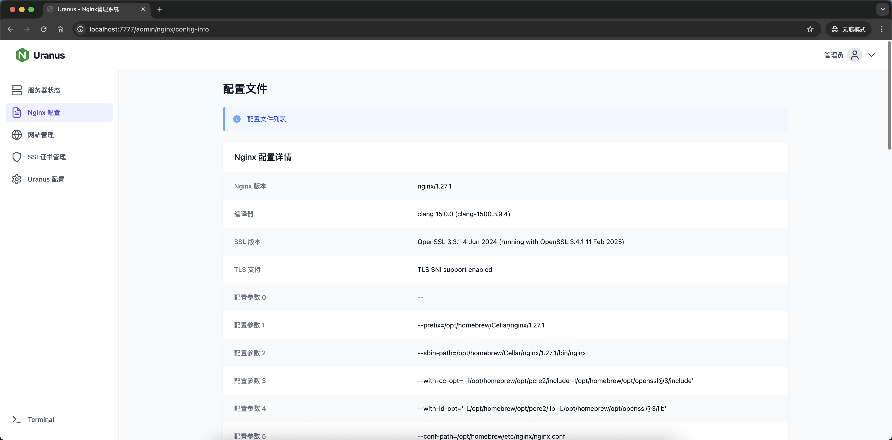
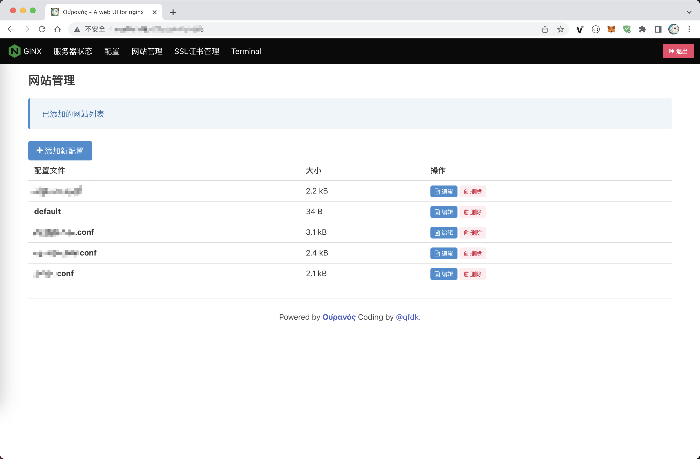
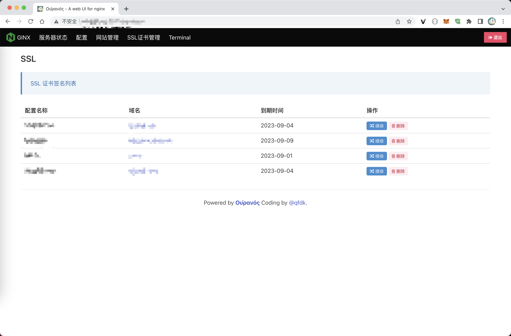
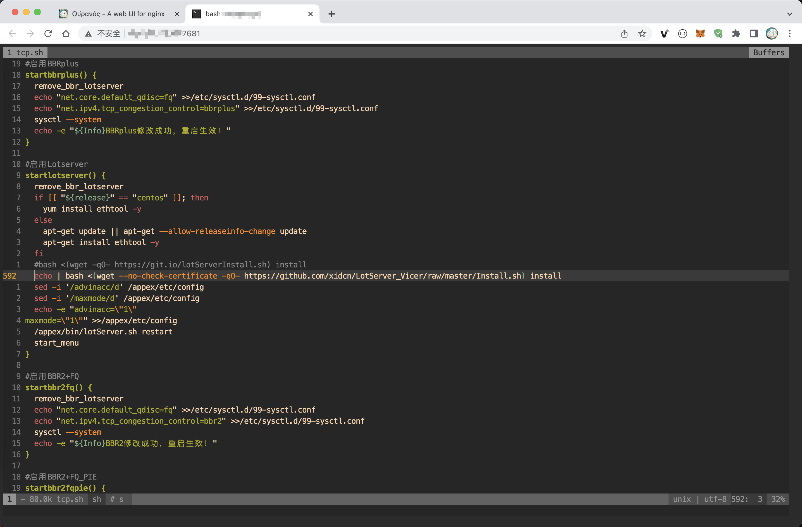
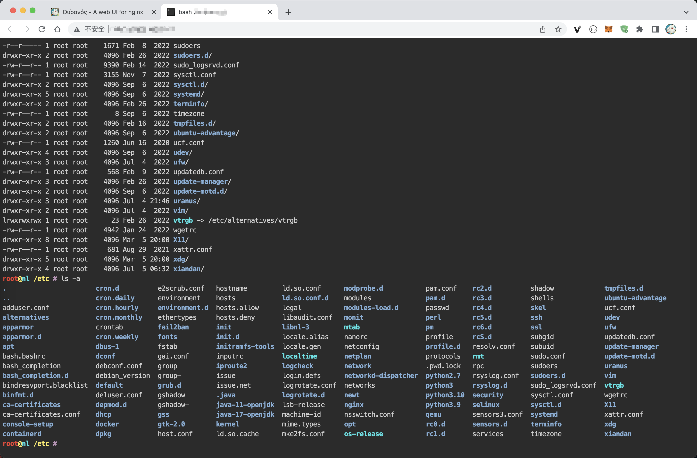

## Οὐρανός (拉丁语：Uranus)

Gin 框架写的 nginx 图形界面管理程序，可以 增、删、改、查 nginx的所有配置。
之前使用宝塔面板出现了很多未解之谜，比如为啥自动升级这样的问题，而且强制捆绑手机号。
本程序为了完全接管 nginx，然后方便自己进行管理操作。
还可以执行命令

**自用**，暂时不出文档, 任何问题与本人无关。

### ⚠️ 安全说明 / MQTT 远程管理

MQTT 远程管理（远程终端、配置下发、心跳上报）**默认关闭**，不会连接任何第三方服务器。

如需启用，请在 `config.toml` 中配置**你自己的** broker：

```toml
# 强烈建议使用 TLS（mqtts://）、broker 账号密码，并为每个 agent 配置 ACL
mqttBroker = "mqtts://your-mqtt-server:8883"
```

- 所有经 MQTT 下发的命令必须携带本 agent 的 `token`（见 `config.toml`），否则会被拒绝。token 不会出现在心跳等 MQTT 消息中，只通过 `controlcenter` 的 HTTPS 注册接口交给控制中心。
- HTTP 接口同理：`POST /update-config` 需要请求体里同时带上 `uuid` 和 `token`（`token` 只用于鉴权，不能借此修改 token）；`POST /upgrade` 需要登录或携带 `token`。在线升级仅支持 Linux。
- 首次启动会生成随机管理员密码并打印在日志中，请登录后立即修改。
- 报告安全问题请见 [SECURITY.md](SECURITY.md)。

## 功能特性

* SSL 自动更新 : [Lego](https://github.com/go-acme/lego)
* 平滑更新支持 : [cloudflare/tableflip](https://github.com/cloudflare/tableflip)
* 数据库支持 : [gorm](https://github.com/go-gorm/gorm)
* SQLite : [SQLite](https://github.com/go-gorm/sqlite)
* Terminal : [ttyd](https://github.com/tsl0922/ttyd)
* VSCode : [vscode](https://github.com/microsoft/vscode)
* 一键升级

### 一键脚本

```bash
# 支持 Ubuntu 22.04 及以上（发布的程序需要 glibc 2.34+）
wget -qO- https://de.qfdk.me/uranus/install.sh|bash
# 升级脚本
wget -qO- https://de.qfdk.me/uranus/upgrade.sh|bash
# 杀死进程
kill -9 $(ps aux|grep "uranus"|grep -v grep|awk '{print $2}')
```

### Nginx 的安装位置

不同系统的 nginx 装在不同的地方，Uranus 不按发行版猜路径，而是以 nginx 自己的说法为准：

- 可执行文件：优先用 systemd 服务（`nginx.service`，OpenResty 是 `openresty.service`）实际启动的那个，其次是 PATH 里的 `nginx`，最后查各系统的常见位置（Homebrew、源码编译的 `/usr/local/nginx`、OpenResty 等）
- 主配置和 PID 文件：取 `nginx -V` 的编译参数；systemd 服务用 `-c` 指定的主配置、nginx.conf 里的 `pid` 指令优先
- 网站目录：nginx.conf 的 http 块里 include 的目录。Debian、Ubuntu、CentOS 系是 `conf.d`，Alpine 是 `http.d`，Homebrew 是 `servers`。源码编译、OpenResty 和 Arch 默认没有引用任何目录，「网站」页面会提示，并可以一键在 nginx.conf 里加上 include
- 证书目录：nginx 配置目录下的 `ssl`
- 启停：nginx 由 systemd 服务运行时用 `systemctl`，否则直接用 `nginx -s`

需要时可以在 `config.toml` 里用 `vhostpath`、`sslpath` 指定网站目录和证书目录。「Nginx 配置」页面列出了检测到的所有位置。

`scripts/test-nginx-layouts.sh` 会在 Docker 里依次安装各发行版的 nginx，检查 Uranus 找到的位置，再像在页面上一样保存一个网站，启动、重载、重启、停止 nginx，并确认网站能访问。

### 截图预览









## 赞助

<a href="https://voilapro.app/?ref=github-uranus"></a>

本项目由 [Voilà Pro](https://voilapro.app/?ref=github-uranus) 赞助支持 —— macOS 语音输入工具。按住快捷键说话，文字直接落到光标处，中英法混说也能识别。
